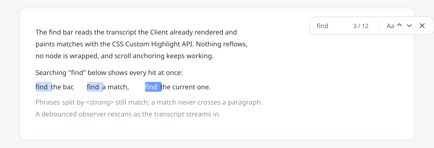

# DSH CtrlF

Press **Ctrl+F** inside a DeepSeek Harness conversation and search the transcript
you are looking at: every match is highlighted, and you step through them
without the page jumping around.



## What it does

| Action | Key |
| --- | --- |
| Open the find bar | `Ctrl+F` / `Cmd+F` |
| Next match | `Enter` or `F3` |
| Previous match | `Shift+Enter` or `Shift+F3` |
| Close | `Esc` or the × button |
| Match case | the `Aa` button (remembered) |

The counter reads `current / total`; an empty result reads "No results".

## Why it feels different from a browser find

- **Matches across inline markup.** The transcript is rendered Markdown, so one
  sentence is often several text nodes (`<strong>`, `<em>`, soft line breaks).
  DSH CtrlF searches a virtual concatenation of the visible text nodes, so a
  phrase split by markup still matches. Block boundaries insert a NUL sentinel
  no needle can contain, so a match never straddles two paragraphs.
- **Does not touch the DOM.** No `<mark>` wrapping, no node cloning. Matches are
  painted with the CSS Custom Highlight API (`::highlight()`), which is a
  presentation layer: nothing reflows and the host's own scroll anchoring and
  virtualisation keep working.
- **Survives streaming.** New turns and token-by-token output keep arriving while
  the bar is open. A debounced `MutationObserver` rescans, and a rescan never
  throws the user back to match #1.
- **Looks like the host.** Colours come from the `--dsw-alias-*` theme tokens, so
  light and dark themes both work; UI text goes through `ctx.locale`
  (zh / en / ja / es / fr / de / ru / pt).

## Install

DSH resolves bundles from a GitHub package. Pick whichever fits your setup:

```bash
# from the Harness UI: Plugins -> Add plugin -> paste the repository
# or from a checkout
git clone https://github.com/Johnson-lab1111/dsh-ctrlf.git
```

Then install the package directory as a bundle in your profile and enable it.
The bundle contributes one Client row; there is nothing to configure.

## Files

| Path | Role |
| --- | --- |
| `client.js` | Browser half: the find bar, matching, highlighting, scrolling |
| `index.js` | Host half: intentionally empty (the bundle row needs a module) |
| `cordis.patch.yml` | Inserts the `dsh-ctrlf` plugin row |
| `locale/*.json` | Title and description shown in the plugin list |
| `icon.svg` | Plugin icon |

## Privacy

- No network requests. The module makes none at all.
- No session events, no writes to disk.
- The search query lives in page memory only and is dropped when the bar closes.
- The only persisted value is one boolean, `dsh.find.caseSensitive`, in
  `localStorage`.
- The Host half registers no service, no route, and no global.

## Licence

MIT — see [LICENSE](LICENSE).
